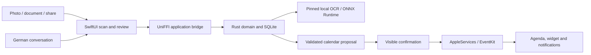

# rehab-plan-ocr · Laßnitzhöhe

A native iPhone app for turning rehabilitation schedules into reviewed calendar
appointments. The German interface supports photo and document intake, local OCR,
correction, agenda browsing and spoken calendar requests. Calendar changes require
visible confirmation. A widget, share extension and notification content extension
use the same bounded local services.

## Architecture



The Rust core owns validation, revisions, persistence and write recovery. Apple
services own platform effects; SwiftUI owns interaction. Speech, OCR and calendar
operations run locally after their required assets are prepared. Initial downloads
and Apple speech-asset setup can require an Internet connection.

## Workspace

| Area | Responsibility |
| --- | --- |
| [apps/ios](apps/ios/README.md) | App, extensions, XcodeGen specifications and Swift probes |
| `packages/rust` | Domain, SQLite storage, OCR, CLI and UniFFI exports |
| `packages/apple` | Platform services, generated bindings, vendored VAD and optional assistant runtime |
| [ml](ml/README.md) | Data preparation, training, evaluation and model registry |
| `tooling` | Setup, checks, builds, source packaging and maintenance |
| `config` | Pinned toolchains, simulator profiles and storage policy |
| [docs](docs/README.md) | Architecture, development, research and product guides |

## Prerequisites and setup

Use an Apple Silicon Mac, Xcode with the selected iOS SDK, Rustup, Python 3.11+
for bootstrap, curl and Make. Git is needed for a checkout, source packaging and
pinned upstream research checkouts; the extracted source supports ordinary setup,
checks and unsigned builds without repository Git metadata. Exact versions and
checksums live in [versions.json](config/toolchains/versions.json): Rust 1.98.1,
Python 3.12.13 and Xcode builds 17E192 or 17E202. The local UI test profile requires
iPhone 17 with iOS 26.4 / 23E244; see [simulator profiles](config/testing/simulator.json).

Run from the project root, including when its path contains spaces:

```sh
make bootstrap
make doctor
make restore
make convert TARGET=all
make build TARGET=simulator
make build TARGET=device
```

`bootstrap` and `restore` are explicit download steps using pinned versions and
lockfiles. Weights stay under ignored `.local/models`; they are not in the source
ZIP. `convert` verifies the already deployed OCR format. Ordinary builds use the
prepared assets and fail on missing or changed resources. The device target is
unsigned and does not install on a phone. Builds require 20 GiB of free working
reserve plus their peak budget (4 GiB for an ordinary build; 16 GiB for simulator
tests). See the [development guide](docs/development/README.md).

The default build uses installed Apple system voices. The optional
[personal Victoria profile](docs/development/personal-victoria.md) retains its
separate pinned speech model, configuration and original stored voice preference.
It requires additional explicit setup and is not selected by `make build`.

## Verification

```sh
make lint
make test
make inventory-repository
make check-runtime-inventory
make check-bindings
make test-ios
make test-visual-baseline TEST_ARGS='--run .local/runs/visual-check-NEW'
```

`make test` covers Rust, Python tools and focused Swift probes, including review,
confirmation, persistence, cancellation, speech endpoints and playback contracts.
Simulator tests use synthetic data and disposable devices. Visual checks compare
the committed references without replacing them. The
[current verification record](docs/development/verification.md) distinguishes
passes from storage-blocked checks and known limitations.

## Source submission

From a clean committed checkout:

```sh
make source-zip
make verify-source SOURCE_ZIP=".local/submissions/rehab-plan-ocr-<full-commit>.zip"
```

The ZIP and `.zip.sha256` sidecar include a single `rehab-plan-ocr/` source root.
Stable ordering, fixed timestamps and stored entries make repeated packaging of
the same commit byte-identical. The source manifest records commit provenance,
paths, executable modes and SHA-256 hashes; it does not hash itself. Private data,
models, generated products, caches, Git metadata and local agent instructions are
excluded. See [archive verification](docs/development/source-archive.md).

## Current limitations

Experimental custom models remain unqualified. Synthetic tests and simulator
playback do not establish real-speech reliability, real-photo accuracy or physical
device performance. Apple speech availability depends on hardware, locale and
installed assets. Historical comparisons and evidence-bound model trials require
their original private inputs and sometimes a Git checkout. These are separate
from the ordinary setup above.

## License

First-party code is available under the [MIT License](LICENSE). Dependencies,
model assets and supplied clinic artwork retain their own rights and notices;
see [third-party provenance](docs/third-party/README.md). The app identifiers,
German UI and stored-data formats are preserved.
