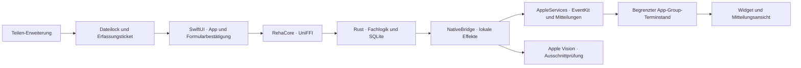

> Historical record: technical findings retained from the archived development sequence. Project dates, build labels and source references have been normalized. This record is not a new test, delivery approval or signing attestation; unaltered evidence and original validity dates are held in the external private archive.

# Native Architektur

Die SwiftUI-App und ihre Erweiterungen liegen unter `apps/ios`. Es gibt keine Webview,
keinen Webserver und keinen Tauri-Adapter mehr. Einstieg und verbindliche Werkzeuge:
[README](../../README.md), [iOS-Build](../../apps/ios/README.md), [Prüfstand](../development/status.md).

## Zuständigkeiten und Grenzen

`packages/rust/reha-core` enthält Bildaufbereitung, Parser, Validierung, Quellenzuordnung,
Kalendervorschläge, Rücknahme, ICS und die Referenz-CLI. `packages/rust/reha-ffi` stellt die
native Schnittstelle und synthetische Prüfdaten bereit. `packages/apple/AppleServices`
kapselt Kalender, Mitteilungen, Bild-/Dokumenteingang, Dateischutz und lokale Diagnose.
Die UI erstellt keine beliebigen Kalender-Schreibaufträge: bestätigte Vorschläge,
Revisionen und Journalprüfung bleiben im Rust-Kern verbindlich.

## Nebenläufigkeit und Abbruch

App und Erweiterungen verwenden Swift 6. UI und Systemdialoge sind am MainActor;
EventKit-Dienste besitzen serialisierte Queues. UniFFI-Aufrufe laufen außerhalb der
UI, während die Plattformbrücke synchrone Rust-Effekte in native Aufträge übersetzt.
Mitteilungssnapshots und Systemplanung sind asynchron und zeitlich begrenzt.

Ein Erkennungslauf belegt die Pipeline. Abbruch wird vor Stufen und zwischen
Ausschnitten geprüft; ein einzelner ONNX-Aufruf ist nicht vorzeitig unterbrechbar.
Generationstickets verhindern die Übernahme alter Kamera-, Foto-, PDF- und
Sprachrückmeldungen. Vollständiges Löschen sperrt die Annahme, wartet auf alle
Produzenten und löscht erst danach. Die Teilen-Erweiterung nutzt zusätzlich einen
persistenten Dateilock; alte Rückmeldungen können gelöschte Daten nicht neu anlegen.

## Kalender und Erinnerungen

Vorschau, Bestätigung und Ausführung sind getrennt. Der Kern schreibt die Absicht
vor dem EventKit-Aufruf ins Journal; unklare Ergebnisse sperren weitere Änderungen
und benötigen einen bestätigten Prüfablauf. Aktualisieren liest ausschließlich.
Aktuelle Kalenderwerte werden vor einer Änderung erneut mit dem Vorschlag verglichen.
Fremde Notizen, Kalenderalarme, Serien und Einladungen bleiben geschützt.

Schema 8 führt gemeinsame Zuordnungen für Importe, manuelle und sprachlich erstellte
Termine. Historische Importbelege bleiben unabhängig. Löschungen behalten Herkunft
und Rücknahmebezug. Ein Terminlink löst die aktuelle Kalenderinstanz auf und
unterscheidet fehlende Zuordnung, fehlenden Zugriff und gelöschten Termin.

App-Erinnerungen übergeben einen Kalenderalarm erst nach bestätigter Systemplanung.
Bei ungeklärtem Abschluss bleibt die Kalenderreserve bestehen. Kapazitäten sind auf
60 reguläre Aufträge sowie einen Test und drei Schlummeraufträge begrenzt. Ein
verspäteter Testabschluss kann eine neuere Testmitteilung nicht entfernen. Aktivierung
und relevante Änderungen lösen Nachplanung aus; Hintergrundaktualisierung ist eine
zusätzliche Gelegenheit. Geplant, im System ausstehend und beobachtet zugestellt sind
unterschiedliche Zustände.

## Erkennung und fachliche Daten

Der Bytehash des Originals und die Abbildung zwischen Original, korrigierter Seite
und Ausschnitt bleiben erhalten. Jeder Feldwert behält seine Quelle; fehlend,
unlesbar und widersprüchlich sind getrennte Zustände. Extraktionsversion 7 verwirft
veraltete Parser-Caches. Bestätigte und manuell bearbeitete Werte sind vor automatischer
Nachprüfung geschützt; Konflikte werden nicht allein nach Konfidenz entschieden.

Der erste Entwurf wird vor optionaler Nachprüfung gesichert. Unsichere Felder lösen
begrenzte Ausschnittprüfungen mit der vorhandenen OCR und Apple Vision aus. Fehler
oder Zeitlimit lassen den Entwurf erhalten. Referenzen benötigen ausdrückliche
Papierprüfung und Freigabe; aktuelle Originaldurchläufe ohne bestätigte Referenzen
belegen Ausführbarkeit, keine erreichte Genauigkeit.

## Speicherung und Datenschutz

App-Kennung und dauerhafter Speicherpfad bleiben unverändert. `ledger.sqlite` und
`scans/<uuid>` enthalten Fachdaten; Inbox und App-Group-Belege dienen der Wiederherstellung.
Aufbewahrung folgt den Einstellungen; unfertige und fehlgeschlagene Aufnahmen werden
nicht automatisch entfernt. SQLite verwendet Fremdschlüssel, vollständige
Synchronisation und `secure_delete`. Externe Kalender und Fotos bleiben beim Löschen
lokaler App-Daten bestehen.

Technische Diagnose wird getrennt gespeichert: maximal 5.000 Einträge, 14 Tage,
begrenzte Dateigröße, bereinigter Export. Standardprotokolle enthalten keine
Termininhalte, Audioaufnahmen oder Gesprächstranskripte. Modelle sind gebündelt;
Downloadwerkzeuge dienen ausschließlich der Entwicklung. Private Originale,
Referenzen, Modelle, Sicherungen und Buildprodukte bleiben aus Git ausgeschlossen.
