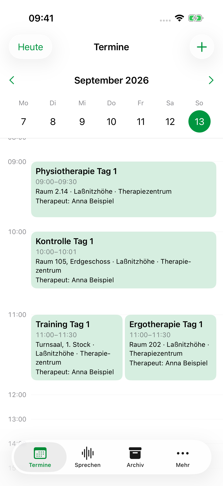
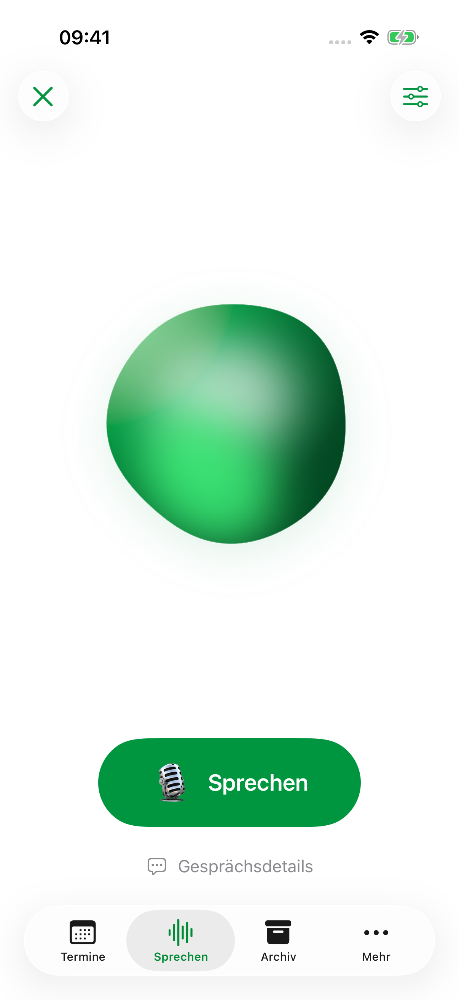

> Historical record: technical findings retained from the archived development sequence. Project dates, build labels and source references have been normalized. This record is not a new test, delivery approval or signing attestation; unaltered evidence and original validity dates are held in the external private archive.

# Vorschau: Kalender, grüner Orb und Apple-Kamera

**Laßnitzhöhe 0.3.0 · Build 2026092610.** Echte Aufnahmen aus dem iPhone-17-Simulator mit iOS 26.4. Alle Termine und Namen sind synthetisch.

| Kalender mit Ort und Therapeut | Sprechen mit grünem Orb |
| --- | --- |
|  |  |

- [Kalender in Dunkel](kalender-dunkel.png), [Wischen über die Wochengrenze](wischen-ueber-wochengrenze.png), [einstellbare Kalendergröße](kalenderdarstellung-einstellbar.png).
- [Tagesliste nach App-Neustart](tagesliste-nach-neustart.png), [größte Bedienungshilfenschrift](tagesliste-groesste-schrift.png).
- [Apple-Kamera](native-apple-kamera.png), [Sprache ohne zusätzliche Datei-Einrichtung](sprache-ohne-dateieinrichtung.png), [ausdrückliche Terminbestätigung](sprachvorschlag-vor-bestaetigung.png).
- [Orb während echter Victoria-Wiedergabe – Video](orb-victoria.mp4), [Bewegung reduzieren](bewegung-reduziert.png), [Sprechen in Dunkel](sprechen-dunkel.png).

## Victoria anhören

Die Stimme und die Audiodateien sind gegenüber Build 2026092609 unverändert:

- [Kalenderbeispiel](../2026-09-26-s12-victoria/victoria-kalender.wav)
- [Langsameres Sprechen](../2026-09-26-s12-victoria/victoria-langsam.wav)
- [Längere Antwort](../2026-09-26-s12-victoria/victoria-lange-antwort.wav)

Der Bildschirmmitschnitt hat keine Audiospur. Er entstand während echter Wiedergabe; [gemessene Pegel](audio-meter.json) und [Videoherkunft](video-origin.json) sind dokumentiert.

## Geprüft und noch am iPhone zu prüfen

Zehn verschiedene gezielte UI-Prüfungen bestehen, außerdem die Swift-Prüfungen für Kalenderprojektion, Sprachregeln und geordnete Einstellungen. Der signierte Geräte-Build und das private Updatepaket sind geprüft. [Nachweise](verification.json).

In diesem Simulator ist die lokale deutsche Diktiererkennung nicht verfügbar. Der Einstieg zeigt nach der normalen iOS-Berechtigung einen [verständlichen Hinweis](spracherkennung-nativer-hinweis.png); Abbrechen und erneute Bedienbarkeit sind geprüft. Freie Foundation-Models-Aufrufe scheitern hier an fehlenden Daten in Apples `SensitiveContentAnalysisML`; der [Hinweis im Gespräch](freies-gespraech-modellstatus.png) und die [technische Diagnose](foundation-status.json) sind dokumentiert. Echte Mikrofoneingabe mit längeren Pausen, freie Modellantworten und ein echtes Kamerafoto benötigen daher die anschließende Prüfung auf dem iPhone.

Die Installation dieses Updates erfolgt nach ausdrücklicher Freigabe der Vorschau und Hörproben, mit frischer Sicherung und Datenvergleich. Bis dahin bleibt Build 2026092609 auf dem iPhone.

[Umsetzung und technische Grenzen](../../fluid-calendar-voice.md).
