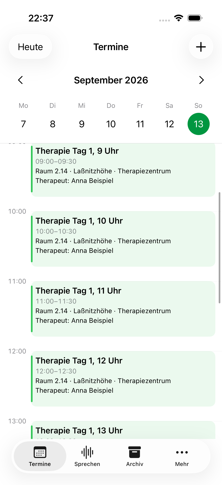
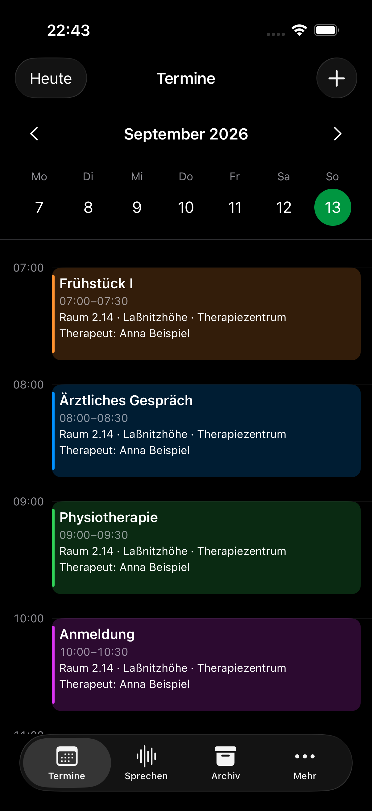
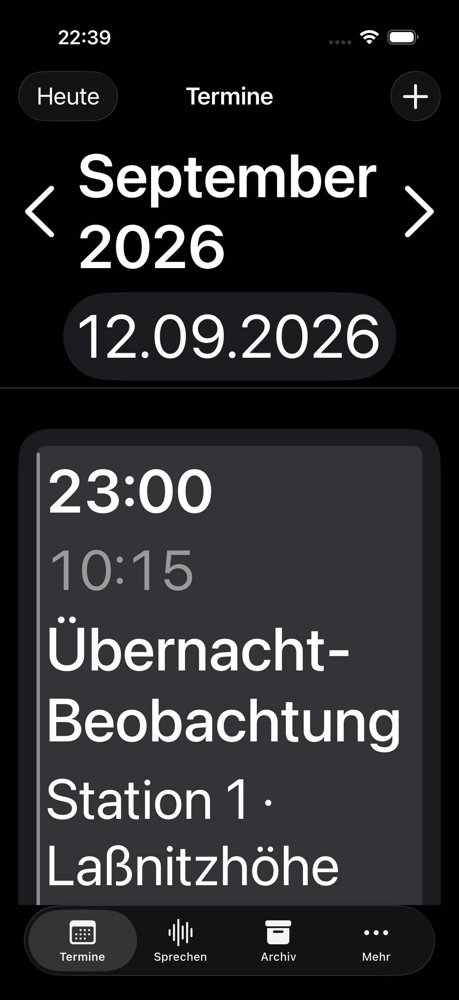
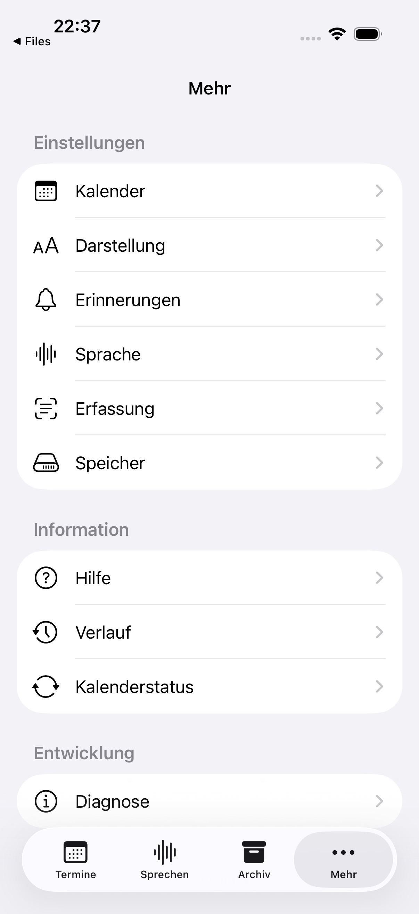
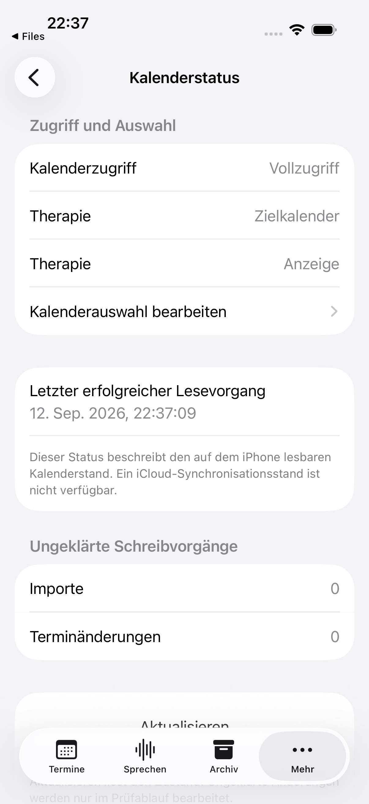
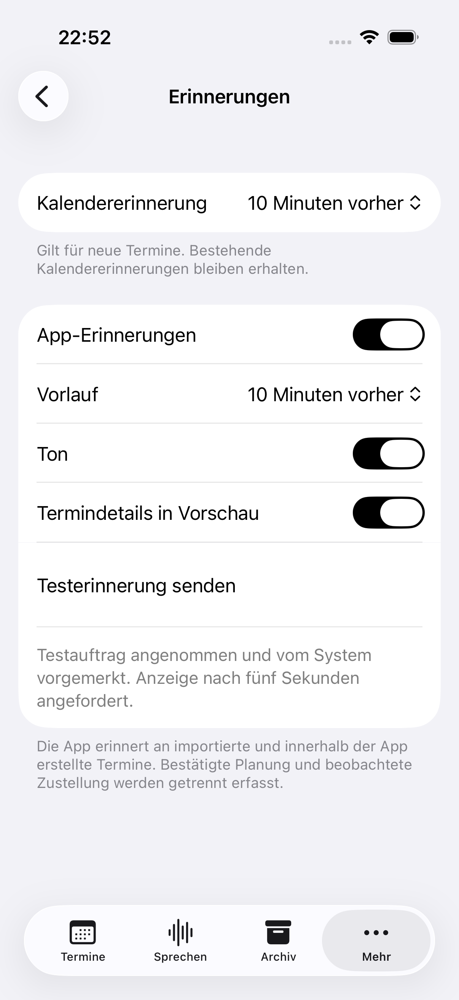
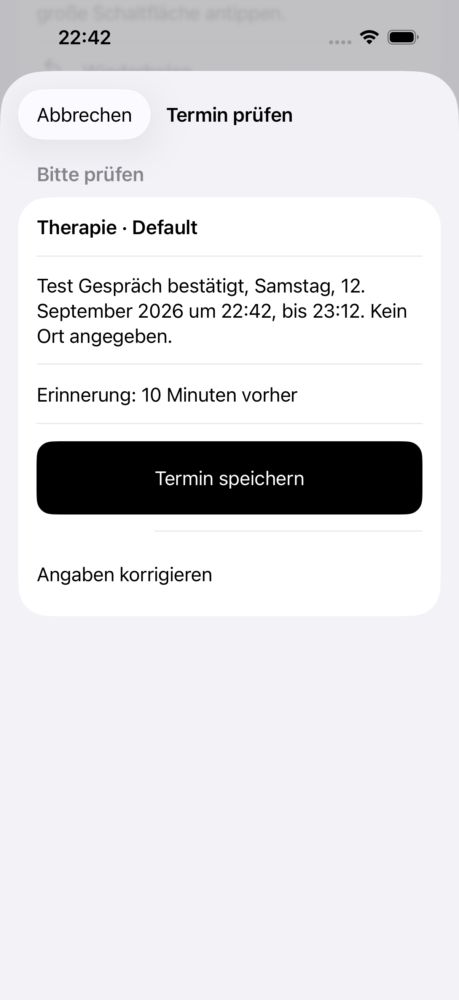
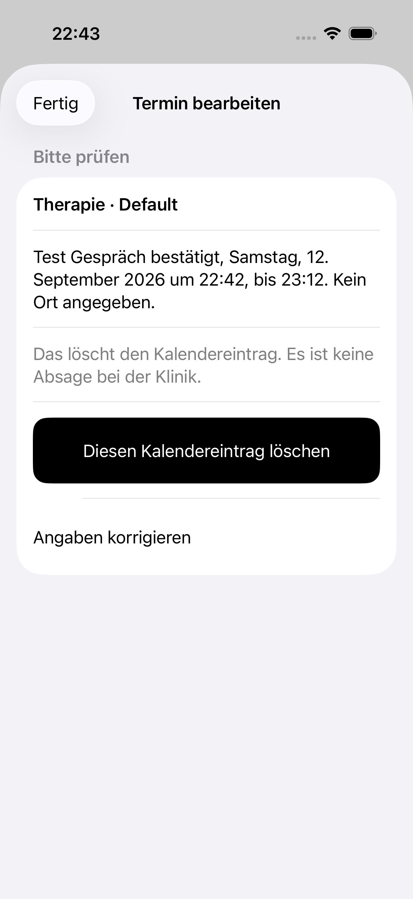
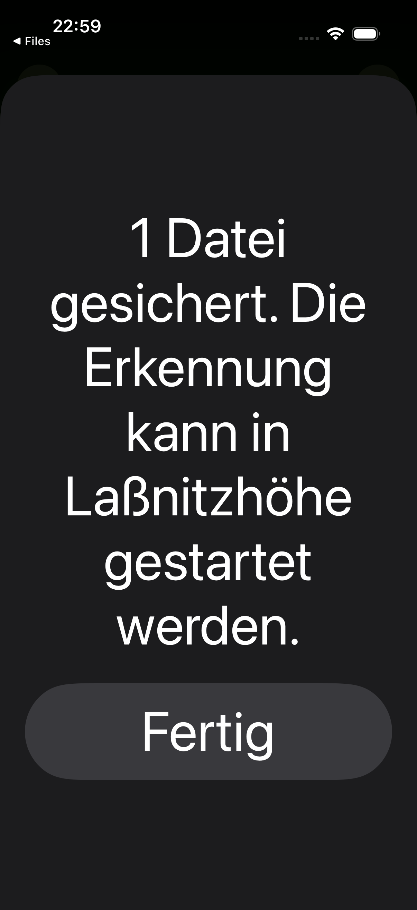

> Historical record: technical findings retained from the archived development sequence. Project dates, build labels and source references have been normalized. This record is not a new test, delivery approval or signing attestation; unaltered evidence and original validity dates are held in the external private archive.

# Neue Abnahmevorschau – native Qualitätsüberarbeitung

Version **0.3.0**, Build **2026092613**, iPhone-17-Simulator mit iOS 26.4.
Ausschließlich synthetische Termine und öffentliche Testbilder. Dieser Stand ist
noch nicht auf dem iPhone installiert; frühere Gerätefreigaben gelten nicht für ihn.

## Victoria-Hörproben

Echte lokale Kokoro-/Victoria-Ausgabe mit 24 kHz. Die Wortmarken liegen neben den
WAV-Dateien. Technisch auf gültige Ausgabe, Reihenfolge, Abbruch und lange Antworten
geprüft; Aussprache und subjektive Verständlichkeit benötigen Hörabnahme.

- [Frühstück, Nummerierungen und Räume · 11 s](victoria-fruehstueck.wav)
- [Datum, Uhrzeiten und Physiotherapie · 14 s](victoria-kalender.wav)
- [Langsames Sprechen · 20 s](victoria-langsam.wav)
- [Längere Antwort · 31 s](victoria-lange-antwort.wav)

## Simulatorvorschau

Alle **39 aktuellen UI-Tests** sind durch erfolgreiche vollständige beziehungsweise
ergänzende Läufe abgedeckt. 21 unveränderte Bildschirmaufnahmen zeigen ausschließlich
synthetische Daten. Videos dokumentieren jeweils den vollständigen Testablauf, auf
590 Pixel Breite verkleinert, ohne Tonspur. Die WAV-Dateien sind separate Hörproben.

- [Kalendergesten · Video](kalender-gesten.mp4): feste Zeitspalte, diagonale Bewegung,
  leerer Nachbartag und wiederhergestellte Uhrzeit.
- [Victoria, Wortmarken und Abbruch · Video](victoria-text.mp4): echte Wiedergabe mit
  sichtbarem Textverlauf und Stopp.

| Kalender hell | Kalender dunkel | Große Schrift |
| --- | --- | --- |
|  |  |  |

| Mehr | Kalenderstatus | Bestätigte Testmitteilung |
| --- | --- | --- |
|  |  |  |

| Erstellen bestätigen | Löschen bestätigen | Teilen mit größter Schrift |
| --- | --- | --- |
|  |  |  |

Weitere Ansichten: [leerer Tag](kalender-leerer-tag.png),
[erhaltene Uhrzeit](kalender-uhrzeit-erhalten.png), [Farblegende](farblegende.png),
[Verlauf](verlauf.png), [Fehler mit Wiederholung](einstellungen-fehler.png),
[Dateiimport mit geschützten früheren Werten](plan-nach-dateiimport.png),
[Plan bei großer Schrift](plan-grosse-schrift.png), [Rücknahme](nach-ruecknahme.png),
[Victoria-Wiedergabe](victoria-wiedergabe.png),
[reduzierte Bewegung](bewegung-reduziert.png), [Teilen hell](teilen-hell.png) und
[Archiv nach Teilen](archiv-nach-teilen.png).

Die Fehleransicht verwendet einen absichtlich ausgelösten Einstellungsfehler.
„Vom System vorgemerkt“ bestätigt die Planung, keine beobachtete Zustellung auf dem
iPhone. Die helle Teilen-Aufnahme stammt aus einem erfolgreichen Übergabeschritt;
der nachfolgende Testwechsel zur App scheiterte dort. Der vollständige ergänzende
Teilen-Test bestand anschließend mit Dunkelmodus, größter Schrift und reduzierter Bewegung.
Sechs Laufzeitwarnungen zur Thread-Priorität während erfolgreicher Sprachtests sind
im Prüfbericht dokumentiert; ihre Ursache ist noch nicht zugeordnet.

[Umsetzung, Prüfergebnisse und offene Geräteprüfungen](../../quality-overhaul.md)
· [Architektur](../../architecture.md) · [Prüfmanifest](verification.json)
· [Aufnahmequellen](origins.json)

## Freigabegrenze

Gemäß [AGENTS.md](../../../AGENTS.md) erfolgt das Geräteupdate erst nach ausdrücklicher
Freigabe dieser neuen Simulatorvorschau und Hörproben, frischer Sicherung und ohne
Deinstallation. Danach werden dauerhafte Daten verglichen und Mitteilungen sowie
Audio zusätzlich auf dem iPhone geprüft. Der Gesamtabschluss bleibt bis zur
Geräteabnahme offen.
