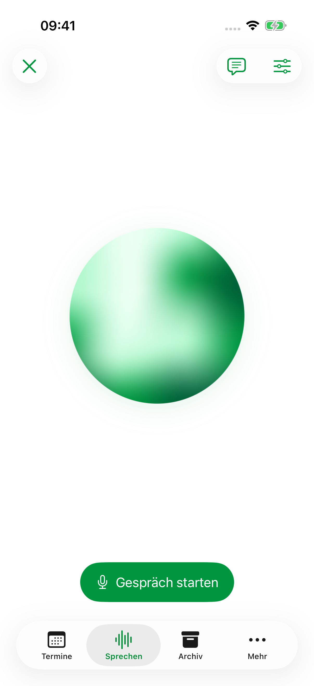
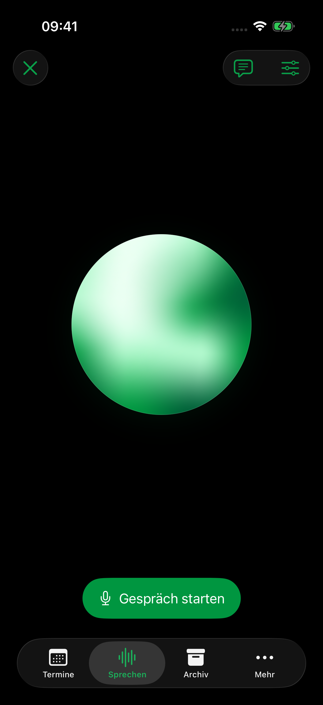

> Historical record: technical findings retained from the archived development sequence. Project dates, build labels and source references have been normalized. This record is not a new test, delivery approval or signing attestation; unaltered evidence and original validity dates are held in the external private archive.

# Vorschau: glatte grüne Kugel und native Gesprächsbedienung

**Laßnitzhöhe 0.3.0 · Build 2026092611.** Echte Aufnahmen aus dem iPhone-17-Simulator mit iOS 26.4. Alle Termine und Namen sind synthetisch. Diese Vorschau ersetzt den Gesprächsentwurf aus Build 2026092610.

| Hell | Dunkel |
| --- | --- |
|  |  |

Die Kugel bleibt rund; weiche grüne Verläufe fließen im Inneren und reagieren sanft auf die gemessene Lautstärke. Unten steht der native Knopf **Gespräch starten**, bei Aufnahme **Fertig**. Das Emoji entfällt. **Gesprächsdetails** sind oben über die Sprechblase erreichbar, daneben die Spracheinstellungen; Abbrechen steht oben links.

- [Kugel während echter Victoria-Wiedergabe – Video](orb-victoria.mp4)
- [Größte Bedienungshilfenschrift](sprechen-grosse-schrift.png)
- [Bewegung reduzieren](bewegung-reduziert.png)
- [Gesprächsdetails](gespraechsdetails.png)

## Victoria anhören

Stimme und Sprachdateien sind unverändert:

- [Kalenderbeispiel](../2026-09-26-s12-victoria/victoria-kalender.wav)
- [Langsameres Sprechen](../2026-09-26-s12-victoria/victoria-langsam.wav)
- [Längere Antwort](../2026-09-26-s12-victoria/victoria-lange-antwort.wav)

Der dreisekündige Bildschirmmitschnitt hat keine Audiospur. Er zeigt tatsächliche Victoria-Wiedergabe; der gemessene Ausgang enthält 105 Wiedergabeframes und einen Spitzenpegel von 0,3959. [Pegel](audio-meter.json) · [Videoherkunft](video-origin.json) · [Herkunft der Bilder](screenshot-origins.json).

## Prüfung und Geräteupdate

**Fünf gezielte UI-Prüfungen bestanden.** Geprüft sind die Knopfanordnung und Gesprächsdetails, Texteingabe und Kalenderantwort, Wiedergabe und Abbrechen, Tabwechsel, Spracheinstellungen, der native Erkennungshinweis, Hell/Dunkel sowie größte Schrift. Während Wiedergabe verändern sich die Orb-Bilder; bei eingeschaltetem „Bewegung reduzieren“ bleiben zwei Aufnahmen im Abstand von einer Sekunde identisch. Simulator-Build, signierter Geräte-Build und privates Updatepaket sind geprüft. [Prüfnachweise](verification.json).

Die bereits bekannten Simulatorgrenzen bleiben: lokale deutsche Diktiererkennung ist dort nicht verfügbar; freie Foundation-Models-Antworten scheitern an fehlenden Systemmodelldaten. Echte Mikrofontranskription, freie Modellantworten und die Audioausgabe des iPhones benötigen die anschließende Geräteprüfung.

Das Update ist noch nicht auf dem iPhone installiert. Gemäß `AGENTS.md` folgt die Installation nach ausdrücklicher Freigabe dieser Vorschau und der Hörproben, mit frischer Sicherung und Datenvergleich. Auf dem iPhone bleibt bis dahin Build 2026092609.

[Umsetzung](../../smooth-voice.md) · [Kalender- und Kameravorschau der enthaltenen Änderungen](../2026-09-26-s12-fluid/README.md).
