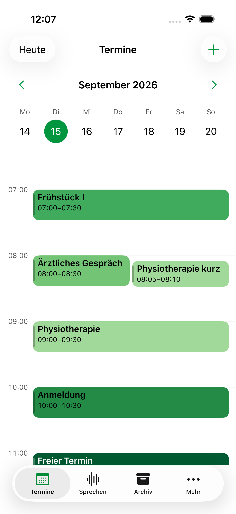
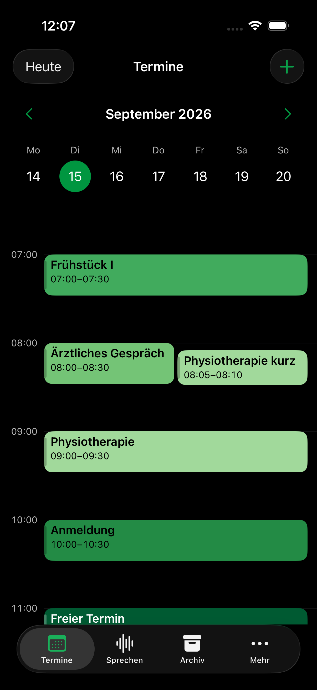

> Historical record: technical findings retained from the archived development sequence. Project dates, build labels and source references have been normalized. This record is not a new test, delivery approval or signing attestation; unaltered evidence and original validity dates are held in the external private archive.

# Kalenderfarben aus Greens-7

Vorschau für **Laßnitzhöhe 0.3.0, Build 2026092622**. Die fünf Grüntöne aus der bereitgestellten [Greens-7.json](Greens-7.json) ersetzen die bisherigen Terminfarben. Sie werden in der vorhandenen Reihenfolge den Terminarten zugeordnet.

| Terminart | Kartenfläche und Legende | Schrift | Textkontrast |
|---|---|---|---|
| Therapie | `#A1D99B` | Schwarz | 12,91:1 |
| Ärztliche Termine | `#74C476` | Schwarz | 9,90:1 |
| Mahlzeiten | `#41AB5D` | Schwarz | 7,21:1 |
| Organisatorisches | `#238B45` | Schwarz | 4,85:1 |
| Sonstiges | `#005A32` | Weiß | 8,37:1 |

Die Kartenflächen und Legendenpunkte verwenden die exakten gelieferten Farben in Hell- und Dunkelansicht. Titel, Uhrzeiten und Zusatzangaben erhalten die zur jeweiligen Fläche passende neutrale Schriftfarbe. Die vorhandenen schmalen Kartenleisten bleiben als dezente Schattierung erhalten. Kategorien, Zuordnung anhand der Termintitel, Kalendergrößen, Anordnung und Auswahlmarkierungen bleiben erhalten.

Der [Kontrastnachweis](contrast.json) vergleicht die Farbwerte im Swift-Code mit der JSON-Datei und berechnet den sRGB-Textkontrast. Der geringste Wert liegt bei **4,85:1** und damit über dem geforderten Verhältnis von 4,5:1, auch für kleine Zusatztexte.

## Simulatorvorschau

Alle Aufnahmen stammen aus dem iPhone-17-Simulator mit iOS 26.4 und öffentlichen synthetischen Terminen.

| Hell | Dunkel |
|---|---|
|  |  |

| Ansicht | Hell | Dunkel |
|---|---|---|
| Tagesliste, oberer Teil | [Bild](greens-list-light.png) | [Bild](greens-list-dark.png) |
| Tagesliste, unterer Teil | [Bild](greens-list-lower-light.png) | [Bild](greens-list-lower-dark.png) |
| Farblegende | [Bild](greens-legend-light.png) | [Bild](greens-legend-dark.png) |
| Größte Schrift: Mahlzeiten | [Bild](greens-large-light-0.png) | [Bild](greens-large-dark-0.png) |
| Größte Schrift: Ärztliche Termine | [Bild](greens-large-light-1.png) | [Bild](greens-large-dark-1.png) |
| Größte Schrift: Therapie | [Bild](greens-large-light-2.png) | [Bild](greens-large-dark-2.png) |
| Größte Schrift: Organisatorisches | [Bild](greens-large-light-3.png) | [Bild](greens-large-dark-3.png) |
| Größte Schrift: Sonstiges | [Bild](greens-large-light-4.png) | [Bild](greens-large-dark-4.png) |

## Prüfung

Simulatorbuild und beide gezielten UI-Prüfungen sind erfolgreich: Terminkarten einschließlich kurzer und überlappender Termine, Tagesliste, Farblegende und alle Kategorien mit größter Schrift, jeweils in Hell und Dunkel. Textkontrast, Farbtreue zur JSON-Datei sowie Swift-Formatierung sind geprüft. Die UI-Läufe liegen unter `/tmp/reha-greens-preview.xcresult` und `/tmp/reha-greens-large.xcresult`. Der zweite Lauf bestätigt die Großschriftprüfung mit besser ausgerichteten Titelaufnahmen.

Diese Änderung betrifft ausschließlich Kalenderkarten, Tagesliste und Farblegende. Der installierte Gerätebuild bleibt im [Gerätebericht](../../calm-voice-device-update.md) dokumentiert; diese neue Farbversion ist zunächst eine Simulatorvorschau.
