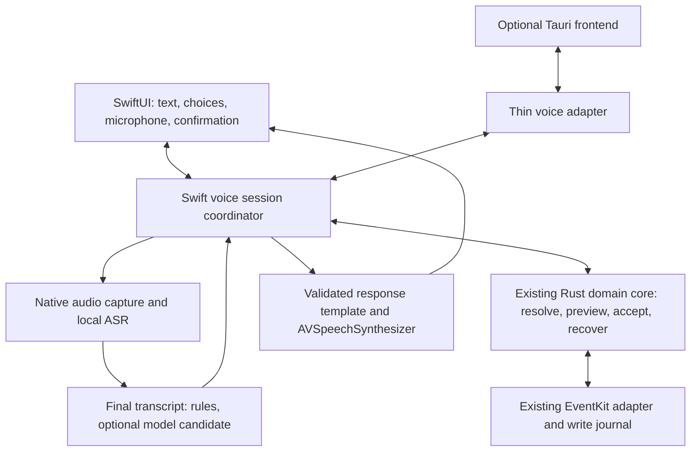

> Historical record: technical findings retained from the archived development sequence. Project dates, build labels and source references have been normalized. This record is not a new test, delivery approval or signing attestation; unaltered evidence and original validity dates are held in the external private archive.

# Easier calendars and local voice assistance

Planning proposal, 12 September 2026. No production changes or model trials are
part of this document. Nothing here selects a dependency for release.

Confidence labels: **High** = strong architectural or directly inspected evidence;
**Medium** = reasonable product hypothesis needing target-user/device evaluation;
**Unproven** = no relevant measurements yet. These are not model confidence scores.

## Confirmed priorities and decisions needed

Confirmed during planning: the calendar problem is **finding and selecting the
destination**. The first voice release must also support **changing and deleting
appointments**. The release sequence below distinguishes internal read-only
prototypes from the requested first usable voice release.

Also confirmed: target **iPhone 17**; speech processing stays on-device while
**explicitly chosen calendars may synchronize**; queries must include
**selected other calendars**, not only app-owned Reha entries.
The voice assistant may also **change and delete existing events in those selected
calendars after explicit confirmation**. **One-time online setup of speech assets
is acceptable**; subsequent speech processing must work on-device and offline.

1. Is one destination per plan
   sufficient, or must individual appointments go to different calendars?
2. How should recurring events and invitation-related consequences be presented?
   Approval must identify the affected occurrence or series and the actual action.
3. Can willing representative patients and a speech-language professional help
   evaluate interaction? Include different speech, language, hearing and motor
   abilities; do not treat age or stroke as one uniform usability profile.

The proposal keeps audio/transcripts/model processing local, permits existing
calendar-account synchronization for explicitly chosen destinations, and extends
queries and explicitly confirmed mutations to selected calendars. Online asset
setup is allowed; it must not upload audio, transcripts or appointment content.
iCloud storage/synchronization is explained by
[Apple](https://support.apple.com/en-nz/guide/icloud/mm15eb200ab4/icloud).

## Findings in this repository

- The shipping iPhone shell is SwiftUI (`apps/ios/Termine`), with generated UniFFI
  bindings to `RehaCore` and native `AppleServices`; Tauri is a retained alternate
  shell. Putting the implementation inside Tauri would invert this architecture.
- `CalendarSetupView` writes one global `preferences.calendarId`. `PlanModel.load`
  reuses it, and the bottom save area does not expose a destination change row.
  General settings expose timezone and reminders, but no destination picker.
- `DedicatedCalendar.resolve` can prefer the default calendar's CalDAV source.
  “Reha-Kalender verwenden” therefore does not promise a local-only calendar.
- `AgendaService.refresh` resolves app-owned records. It does not enumerate every
  event in every calendar. Answers must name this scope.
- `service/draft.rs` already implements assessment, preview and accept-and-save;
  it preserves revisions, proposal bindings, approval hashes and durable write
  intents. Extend this protection rather than creating a separate voice writer.
- The locked Tauri version is 2.11.5. Its local Swift sources include a Decodable
  `Channel` with `send`, and `Invoke.parseArgs` supplies its decoding context.
  The current calendar adapter instead forwards raw JSON into `NativeServices`.

## Product changes before conversational complexity

**High:** Put a full-width destination row immediately above the save button:
“Speichern in: Laßnitzhöhe — Ändern”. The picker uses large rows with calendar name,
account/source, selection indicator and a color marker that is never the only
identifier. Start with recent writable destinations, with all others accessible.
Show unavailable/read-only choices with a reason rather than losing the user's
place. Revalidate permission and writability when saving.

Changing the destination applies to this plan. Offer “Für neue Pläne merken”
separately; choosing it must not move previously saved appointments. Also expose
the default under Mehr → Kalender. Show “12 Termine in Laßnitzhöhe gespeichert”
and persistent access to Rückgängig. Destination changes invalidate the preview.

**High:** Define duplicate semantics before adding multi-calendar support. Saving
an already imported plan to another destination can mean copy or move. These
must be separate, explicit operations. A default-calendar change does neither.
V1 selects one destination for a whole plan; per-appointment assignment is an
additional workflow if user research establishes a need. Cross-calendar moves
require tested ownership, partial-failure and undo behavior.

**High:** Separate “Kalender anzeigen und vorlesen” (multiple selected calendars)
from “Neue Termine speichern in” (one default destination plus per-plan override).
Show account/source labels when selecting a destination; synchronization is now
explicitly allowed. Do not add custom account logins or upload audio/transcripts
to provide this feature. EventKit reads device-configured accounts. A local save
result does not prove that the calendar provider has already synchronized it.

The existing owned-record agenda cannot satisfy queries across arbitrary selected
calendars. Add a bounded native calendar-query port with scope filtering and
current access status. Deduplicate events already present as app-owned entries;
do not mark external entries as imported or app-created. Full EventKit access does
not replace the user's narrower in-app selection. Answers state their selected
calendar scope rather than claiming to cover every appointment on the phone.
Explain in the calendar-selection screen that selected writable calendars can
also be edited by the voice assistant, with explicit confirmation for each action.
Read-only calendars remain available for queries. A calendar's inclusion does not
itself approve any edit or deletion, and a default destination does not silently
expand the selected-calendar scope.

**Medium:** Make the everyday surface answer “What is next, when, and where?”
before showing administrative detail. Add a visible, labeled “Plan hinzufügen”
action on populated agendas; a lone plus can be hard to discover. Keep existing
tabs, readable appointment cards and one save action. Test 56-point primary
controls as a design starting point, larger text, one-handed use, Switch Control,
VoiceOver and landscape. Avoid required swipe/long-press interactions.

**Medium:** Add “Vorlesen” before ASR. It can help without asking a person to speak
recognizably. Provide repeat, stop and adjustable rate. Keep the complete text
visible, avoid competing with VoiceOver, and retain correction/undo access beyond
a short-lived toast. A tappable equivalent exists from the start of every voice
turn, not only after two failures.

Speech impairment, language impairment and comprehension needs can differ and
co-occur. An ASR improvement cannot address all of them.
[ASHA: dysarthria](https://www.asha.org/Practice-Portal/Clinical-Topics/Dysarthria-in-Adults/),
[ASHA: aphasia](https://www.asha.org/practice-portal/clinical-topics/aphasia/).

## Architecture recommendation

**High:** Preserve audio → interpretation → output as logical boundaries, but do
not require three generative models. Use streaming ASR, a deterministic dialogue
controller and domain resolver, and templated text rendered through system TTS.
An optional model only proposes interpretations of varied phrasing.

The Swift coordinator owns audio lifecycle, current turn, provisional transcript,
slot-filling dialogue, pending question, playback and interruption. The domain
core owns valid values, calendar identity resolution, proposal revisions,
permission to mutate, durable acceptance and actual write outcomes. SwiftUI or JS
renders snapshots and submits explicit user actions; neither owns a competing
dialogue state machine.

Define the Swift module against a `VoiceDomainPort` abstraction. The native host
injects its existing UniFFI-backed application. A Tauri host must connect to its
existing Rust application instance: it must not embed another Rust core/runtime
and open a second independent ledger through another UniFFI library. Reverse
Swift-to-Rust requests and cancellation need an adapter spike if Tauri is required.

### Interpretation options

| Approach | Benefit here | Limitation | Recommendation/confidence |
| --- | --- | --- | --- |
| Rules and domain lexicon | Fast, inspectable, handles dates/time/negation explicitly | Unfamiliar phrasing needs clarification | Baseline, High |
| Small trained intent/slot model | Predictable resource cost; potentially better phrase coverage | Needs representative labeled speech transcripts, including ASR errors and out-of-scope examples | Evaluate after data, Medium |
| General local LLM | Flexible phrasing and elliptical follow-ups | Can supply plausible wrong slots; availability and latency vary | Optional candidate fallback, Medium |
| Hybrid | Rules handle common cases; model improves coverage behind identical validators | More evaluation paths | Preferred architecture, High; measured advantage Unproven |
| Direct audio-to-intent model | Could avoid losing information through a transcript | Harder to inspect corrections and local failures; no patient evidence | Later research only, Medium |

Grammar-constrained output guarantees shape, not correct understanding. Domain
restriction must not force out-of-scope speech into a valid appointment command.
Evaluate a grammar/rules baseline before training a classifier or adding a model.
No model receives tools that can mutate the calendar.

An intent needs more than four nullable strings. Proposed types distinguish:

- action: query, navigate, create, edit, delete, cancel-dialogue,
  select-destination, undo-request, unknown;
- target reference, e.g. an existing appointment versus the proposed new time;
- slot states: missing, candidate, ambiguous, resolved, user-corrected;
- evidence: final turn ID, source text span, alternatives when supplied by ASR,
  and whether a value came from explicit user input, context or a configured default;
- target calendar and read scope, identified by native IDs after resolution;
- date/time/duration and time zone, with validation rather than model inference.

Normalize Austrian forms and self-corrections (“halb zehn”, “dreiviertel zehn”,
“Dienstag, nein Mittwoch”) explicitly. Do not treat an LLM's confidence number as
a probability. Do not infer treatment schedules or missing duration from general
medical knowledge. Ask only for fields required by the current action; a query
does not need a duration. Optional room/therapist blanks remain optional.

### Confirmation and one-action saving

**High:** Readback is assembled from a fully resolved, current proposal. For a
single change, show/speak the title, absolute date, time/duration, destination and
what changes. For a photo plan, summarize date range, destination, ready count and
deferred count rather than forcing the user through every row again.

The existing save button is the confirmation for imports/creation. Changes and
deletions get equally explicit “Änderung speichern” and “Diesen Kalendereintrag
löschen” controls. Deleting an ordinary personal calendar entry does not itself
cancel the clinical booking; state that distinction in the deletion flow. Shared
or invited events may have account-side notifications and need separate handling.
An ambiguous “absagen” requires clarification. Voice may become an alternative
confirmation modality after evaluation, bound to exactly that proposal revision.
Never interpret “ja” before the prompt, the app's own playback, ambient speech or
a partial transcript as approval. Process the whole completed turn including
negation/correction. For v1, a large save/change button is the safest default;
support alternative accessible input rather than presuming everyone can tap it.

For edits, resolve exactly one existing target before collecting replacement
values; show/speak before and after. For deletion, resolve and read the exact
event and affected calendar. Keep removal approval explicitly bound to this
deletion proposal; ordinary save acceptance must not enable removals. The current
photo-plan APIs do not establish a complete general event-edit/delete API: extend
the domain command surface while reusing its ownership, preview, journal and undo
protections. Do not route voice deletion through incomplete-plan replacement.

External-event edits and deletion are included in the first usable voice release.
Introduce a distinct external-event reference and mutation proposal: calendar and
event identifiers, occurrence identity where applicable, a current before-value
snapshot and the requested change. Recheck selected scope, writability and the
before-values at acceptance. Journal only the explicitly confirmed operation and
its recovery data; never claim the app originally created or imported that event.
Undo must detect later external changes. For deleted events, recovery may create
a replacement with a different identity; test supported metadata and recurrence
behavior, and do not promise to reverse provider notifications or invitations.

At acceptance, revalidate destination, calendar contents, conflicts and draft
revision, then persist the accepted proposal and write intent through the shared
core. Calendar effects and SQLite are not one atomic transaction; preserve the
existing journal/reconciliation treatment for interrupted or uncertain writes.
Report actual saved/already-existing/failed/uncertain/deferred outcomes. Changes
after a readback require a fresh proposal. A voice correction never fabricates
photo evidence; manual voice-created items need honest input provenance.

## Components: verified facts versus choices

| Component | Assessment and recommendation | Confidence |
| --- | --- | --- |
| Apple SpeechAnalyzer/SpeechTranscriber | First ASR spike. On-device transcription can require system-managed asset downloads. Probe device/locale support and installed assets; explicitly enforce local recognition for any legacy SFSpeechRecognizer fallback. | High on constraints; patient accuracy Unproven |
| FluidAudio/Parakeet TDT v3 | Credible German comparison. It is batch/sliding-window transcription, distinct from the English EOU model. Do not accept 66 MB as an iPhone total-memory guarantee. | High on distinction; device footprint/accuracy Unproven |
| Apple Foundation Models | Optional interpretation fallback. The chosen iPhone 17 meets the hardware prerequisite; enabled Apple Intelligence, supported language and downloaded models still need checking. Guided generation does not establish semantic accuracy. | High on constraints; usefulness Medium |
| Gemma 4 E2B/LiteRT-LM | Real alternative, not an assumed nonexistent model. Google lists Apache 2.0; LiteRT-LM has Swift/iOS support. Do not ship it for a small intent vocabulary without measured gains that justify footprint and maintenance. | High on existence; defer recommendation Medium |
| AVSpeechSynthesizer | V1 choice. Prefer an installed suitable German voice; enhanced voices require downloading. Test comprehension and familiar pronunciation before replacing it. | High on initial choice; ideal voice/rate Medium |
| German Kokoro Martin | Fine-tune and ONNX conversion exist. Packaging, phonemization, dependency licenses and pronunciation remain separate work. Some newer packages claim alternate phonemizers; inspect the exact artifact rather than declaring every Kokoro path GPL-bound. | Medium; defer |
| WhisperKit | Keep outside the initial shortlist as requested. Its memory requirement is model/configuration-dependent; “always 1.5–3.9 GB” is not a sound universal claim. Silence rejection is a requirement for every ASR candidate. | High on correction; relative patient accuracy Unproven |

Sources: [Apple SpeechAnalyzer](https://developer.apple.com/videos/play/wwdc2025/277/),
[local recognition requirement](https://developer.apple.com/documentation/speech/sfspeechrecognitionrequest/requiresondevicerecognition),
[FluidAudio model distinctions](https://github.com/FluidInference/FluidAudio/blob/main/Documentation/Models.md),
[FluidAudio measured benchmarks](https://github.com/FluidInference/FluidAudio/blob/main/Documentation/Benchmarks.md),
[Apple Intelligence prerequisites](https://support.apple.com/en-us/121115),
[Foundation Models language support](https://developer.apple.com/documentation/foundationmodels/supporting-languages-and-locales-with-foundation-models),
[guided generation](https://developer.apple.com/videos/play/wwdc2025/301/),
[Gemma model card](https://ai.google.dev/gemma/docs/core/model_card_4),
[LiteRT-LM package](https://github.com/google-ai-edge/LiteRT-LM/blob/main/Package.swift),
[enhanced voices](https://developer.apple.com/documentation/avfaudio/avspeechsynthesisvoicequality/enhanced),
[Martin original](https://huggingface.co/kikiri-tts/kikiri-german-martin),
[Martin ONNX](https://huggingface.co/Godelaune/Kokoro-82M-ONNX-German-Martin),
[alternate package claim](https://huggingface.co/prinzsimo/Kokoro-82M-German-Martin),
[espeak-ng license](https://github.com/espeak-ng/espeak-ng/blob/master/COPYING),
[WhisperKit variants](https://github.com/argmaxinc/argmax-oss-swift#model-selection).

These are documentation/source checks, not benchmark results from our app.
Moving main branches and Context7 excerpts disagree on some API names; pin and
compile a chosen version in the spike. No exact new SDK call shape is promised.

## Timing and interaction

**High:** “Under 1.5 seconds from the last spoken sound” conflicts with 1.2–2.0
seconds of endpointing silence, before recognition finalization and TTS startup.
Measure separately: last speech → endpoint decision; endpoint/Done tap → first
meaningful audio; total turn latency. Proposed warm-path target: p95 under 1.5 s
after explicit Done. Cold model setup is measured separately, never hidden by an
empty acknowledgement. No latency target is yet demonstrated.

**Medium:** Use tap-to-start/tap-to-finish as the primary candidate. Do not require
holding a button through a sentence. Compare a generous configurable automatic
endpoint against manual Done; 2 seconds may still be too short for some users.
No completion based on a partial ASR result. Do not continuously animate/reflow
recognized words under the user's gaze or announce every partial to VoiceOver.

**High:** Stream ASR for feedback, not early mutation. There is no generated
response paragraph to stream in the preferred design: the validated template is
available immediately after resolution. Speak one answer/question at a time.
Prewarming on entry can reduce delay, but measure memory, heat and battery with
the existing OCR workload. A shared resource budget should serialize heavy model
work when needed.

**High:** Include a one-time “Sprachhilfe einrichten” flow with preparation
progress, retry and cancel. Check each chosen engine's assets and runtime
availability; only show “Offline bereit” once the local pipeline is usable.
Foundation Models remains optional if Apple Intelligence is disabled or not yet
ready. Keep the normal calendar UI usable during setup. Verify subsequent use in
airplane mode; if assets later become unavailable, explain that setup needs repair
without silently switching speech processing to a server.

**Medium:** Let users choose speaking rate. AVSpeechUtterance.rate is a framework
rate scale, not a literal playback multiplier; setting it to 0.9 is not a reliable
implementation of “0.9×”. Tune with the chosen voice and actual listeners.
[Apple rate documentation](https://developer.apple.com/documentation/avfaudio/avspeechutterance/rate?changes=_5&language=objc).

## Proposed interface (application contract, not existing SDK APIs)

| Command | Contract |
| --- | --- |
| capabilities | Return permissions, supported/installed locales, available local engines/voices and disabled reasons without starting capture. |
| prepareAssets | Prepare explicitly selected assets and report progress; never send user speech or appointment data with downloads. |
| openSession(context, locale, requestId, eventSink) | Context is an opaque plan/appointment reference and allowed scope; return session ID and authoritative snapshot. |
| beginTurn / endTurn / cancelTurn | Explicit recording lifecycle. Acknowledge capture only once the microphone is actually ready. |
| submitChoice(questionId, choiceId, expectedRevision) | Same path for a tapped answer and a resolved spoken choice. Reject stale question IDs. |
| editSlots(values, expectedRevision) | Validate a manual correction, invalidate old readback/approval and recompute the next question/proposal. |
| confirmProposal(proposalId, expectedRevision, operationKey) | Deliberate confirmation only; shared core revalidates and journals. Idempotent retries cannot create duplicate writes. |
| stopSpeech / repeatResponse(responseId) | Stop/repeat an existing displayed response without changing the domain action. |
| snapshot / attach / cancelSession | Reattach after UI changes, resynchronize state and stop capture explicitly. Cancel after a started write does not promise rollback. |

All events carry `schemaVersion`, `sessionId`, `generation`, `turnId`, monotonically
increasing `sequence`, `stateRevision`, `kind` and typed `payload`. Commands also
carry request IDs. A command acknowledgement means accepted for processing, never
“appointment saved”. Late events from an old generation are ignored.

Event kinds: capabilities/assets; capture state; coalesced audio level; transcript
revision with replace semantics and final flag; question with short text and
opaque choices; validated proposal; response text; speech started/progress/ended;
actual write result; interrupted; recoverable error; session ended. Microphone
audio, model tokens and model internals never cross into the webview. Partial
transcripts are provisional; result/state events must not be dropped. Throttle
meters and partials, bound queues, and recover missed events through a snapshot.

Native SwiftUI consumes a typed async event stream. Tauri, if required, transports
the same envelopes over Channel. A channel is transport, not persistence or proof
that a human saw a confirmation. Display IDs bind choices and approvals to the
same native proposal shown/spoken to the user.

The conversation flow is idle → preparing → listening → interpreting → question
or preview → awaiting confirmation → committing → result. Questions loop back
through explicit input. Interruption can leave any pre-commit state; it closes
capture and invalidates approval. Playback is a separate state dimension so Stop
speech does not cancel an appointment save. At most one active microphone turn.

## Tauri-specific work

**High:** The native iPhone path does not need a Tauri plugin. If the alternate
shell must support voice, expose the shared Swift module through a thin adapter.
The project already demonstrates registration and Rust-to-Swift calls.
[Tauri mobile plugin documentation](https://v2.tauri.app/develop/plugins/develop-mobile/).

**High:** In local Tauri 2.11.5, Swift Channel decoding uses context installed by
`Invoke.parseArgs`; forwarding raw JSON through the existing calendar adapter
loses that context. Parse and retain the channel in the plugin adapter, then give
the voice module a typed event sink. Tauri invokes plugin methods on an IPC queue;
explicitly isolate UI/audio work and asynchronous model work. Never block that
queue with inference or synchronous round trips to Rust.

**High:** Own microphone permissions, any recognizer-specific authorization,
AVAudioSession interruptions/routes, cancellation and app-background transitions
in native code. Plugin registration does not provide them automatically. Limit
capabilities to trusted local app content; an event channel is not authorization.

**Medium:** Validate Swift concurrency boundaries for the non-Sendable bridge
objects, listener retention/cleanup, webview reloads, SwiftPM model dependencies,
device/simulator build slices, application versus extension availability and
deployment targets against pinned packages. Do not ship microphone/model work in
widgets or notification extensions. Demonstrate full release/archive compatibility
before committing to a third-party runtime.

## Failures to design and evaluate

| Failure | Required behavior |
| --- | --- |
| Dysarthria, very quiet speech, aphasia, self-correction | Preserve pauses and whole-turn corrections; short targeted choices; no demand for complete sentences; optional touch path immediately. |
| Clinic TV, another person, coughs, long silence | Empty/out-of-scope outcomes are valid; never force an intent. No ambient or partial-transcript confirmation. Test false activations separately. |
| Echo from TTS, VoiceOver, hearing aids/Bluetooth route changes | Explicit turn ownership, stop/reconfigure safely, visible audio state; do not assume VAD identifies the user. |
| “Ja, aber nicht morgen” | Interpret the final turn; cancel old confirmation and resolve correction. |
| Relative dates, DST, midnight, “um acht”, duplicate titles | Resolve against pinned turn context and Europe/Vienna; show absolute dates; ask for unresolved alternatives. |
| Unavailable/stale calendar or permission revoked | State what could not be checked; never assert “no appointments” from unavailable data. |
| Phone call, lock, background, process termination | Stop audio, invalidate pending approval. Recover journaled writes; reopen drafts without auto-listening or auto-committing. |
| Destination renamed/removed; sync changes after preview | Re-resolve stable IDs, require new preview if meaning changed, never silently choose another calendar. |
| Recurring/shared/invited events or another person's calendar | Include external events in selected writable calendars; resolve occurrence/series scope, show consequences and require current explicit confirmation. Verify metadata, permissions, recovery and Undo; never silently fall back to a broader action. |
| General medical or unrelated request | Briefly explain appointment scope and offer supported actions. No improvised medical response; fixed help text for urgent requests is a separately reviewed product decision. |
| Model absent/removed, refusal, storage full, thermal pressure | Explain unavailable voice capability, keep calendar UI usable, no automatic cloud fallback. |
| Diagnostics or persisted audio leaks | No transcript/audio/calendar content in normal logs, crash breadcrumbs or analytics; short in-memory audio buffer, delete temporary files. Evaluation recording is separately consented and locally controlled. |

Every control above is a proposed invariant or test case (High confidence in the
need); thresholds and user comprehension remain unproven.

## Spikes, ordered by uncertainty removed

1. **Patient workflow and calendar choice** (Medium hypothesis, highest product
   uncertainty): test a disposable calendar-picker/read-aloud prototype with
   roughly 5–8 representative volunteers as an initial discovery round. Measure
   completion, wrong destinations, help needed and ability to undo. Include
   explicit Done versus automatic endpointing. This is not a statistical safety
   validation.
2. **Device/locale/offline feasibility** (High priority): use the target iPhone 17.
   Test fresh assets, installed assets, disabled
   Apple Intelligence, denied permissions, interrupted initial downloads and
   offline relaunch after the permitted online setup. Establish the
   privacy boundary and record supported versus actually installed German locales.
3. **ASR on representative speech** (winner Unproven): Apple baseline versus
   Parakeet v3; include newer multilingual streaming alternatives only if needed.
   Capture pauses, fatigue, quiet speech, Austrian dates/numbers and clinic noise
   with permission. Measure date/time/negation/intent errors and cutoffs in addition
   to WER. Hold out speakers, not merely random recordings from the same speaker.
4. **Intent comparison on identical transcripts** (Medium): compare deterministic
   rules, rules plus Foundation Models, and only then a small trained model or
   Gemma. Test clean and real ASR transcripts, missing information, ambiguity and
   out-of-scope speech. Measure full slot accuracy, abstention, wrong proposals,
   correction effort and p50/p95 latency. Separate ASR errors from parser errors.
5. **Confirmation/recovery stress test** (High priority before any voice mutation):
   stale proposal, wrong calendar, repeated request, late partial/“yes”, device
   interruption at every write boundary, partial outcomes, duplicate imports and
   external-event edits/deletions, lost calendar selection, recurring-event scope
   and undo after external edits. Release requirement: no mutation without an explicit
   current acceptance, no reported success for uncertain writes; finite tests do
   not prove zero future errors.
6. **End-to-end native performance and listening test** (Unproven): warm/cold
   start, long pauses, rate/pronunciation choices, headphones and VoiceOver,
   battery/thermal state, and concurrent OCR. Measure meaningful first audio from
   both last speech and Done; measure whole-device and app memory, not just a
   model's claimed resident working set.
7. **Tauri adapter compatibility**, only if that shell needs voice (Medium): one
   live session, reverse domain call, ordered events, UI reload, cancellation and
   release archive. Keep native-only delivery independent of this spike.

Proposed implementation order: calendar selection + read-aloud → internal voice
query/navigation prototype → first usable voice release including creation,
changes and deletion of uniquely resolved appointments, including existing events
in selected writable calendars, with explicit confirmation and undo. Queries
include selected other calendars. Changes and deletion are user-requested scope,
not postponed features. Online speech-asset setup precedes offline voice use.
Recurrence presentation, invitation consequences and spoken confirmation versus
accessible button confirmation need design and evaluation. A custom TTS model comes
last, if users prefer it and it improves comprehension enough to
justify its footprint and license/dependency work.

This remains planning only; production implementation has not been requested. The plan
does not change the pending photo-recognition reference-data evaluation or claim
recognition improvements.
